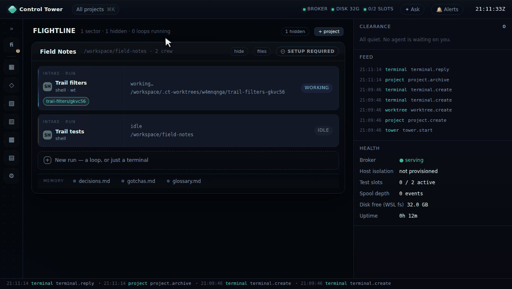

# Control Tower

Control Tower gives you one place to run coding agents on your own machine. Each project has its own terminals. When an agent needs an answer, you can reply from the dashboard. When its changes are ready, you can review the diff and open a pull request from the same window.


-orange?style=flat-square)
[](./LICENSE)



## Run it locally

You'll need Linux or WSL2, Node.js 22 or later, tmux 3.2 or later, and Git. On WSL2, run these commands from your Linux home directory so the checkout lives on the Linux filesystem.

```bash
git clone https://github.com/FluffBaal/control-tower-oss.git
cd control-tower-oss
npm ci
npm run doctor
npm run build
npm start
```

Open [the dashboard](http://127.0.0.1:4870) in your browser. You can also install it as a standalone app from Chrome. A plain shell works out of the box. To use Claude Code, Gemini CLI, or Codex CLI, install the CLI you want on the same machine.

## Try a project

1. On the **Flightline**, click **+ project**. Give the project a name and enter the path to a local Git repository.
2. Click **New run**, then **Just a terminal**. Choose a shell or a coding agent. If you want the task on its own branch and in its own directory, select a Git worktree.
3. Open the terminal to follow the work. The attention queue collects questions and permission requests across projects. You can answer there or turn on desktop notifications and come back when you're needed.
4. For a task in a worktree, open the **review** tab. Read the changes file by file, ask the agent for a revision, merge locally, or click **Open PR**.

Press **Ctrl+K** or **Cmd+K** to jump to a terminal. Type `/text` in the command palette to search the logs across terminals.

## Working with several agents

- Use the **Board** to keep a backlog. A **Mission** can take work through planning, implementation, tests, and review. You can follow each run and read its report afterward.
- Set a default model and reasoning effort for a project, or choose them for an individual terminal. The skills library lets you import skills, group them into bundles, and choose which ones an agent gets.
- Agents can send each other messages with `towerctl mail`. They can also record project decisions in shared memory so the next agent can pick up where they left off.
- Choose a provider account and GitHub identity for each terminal. If you use multiple Claude subscriptions, **Runway** can switch between the accounts you select as they approach a usage limit.
- To run browser tests, install Chromium with `npx playwright install chromium`. The built-in test runner assigns a port to each run and shows the results in the dashboard. A small Playwright project is included in [examples/e2e-project](./examples/e2e-project).
- The built-in assistant can propose actions such as starting a terminal. By default, you confirm its proposed changes before they run.

## What can an agent access?

Run Control Tower on a trusted, single-user machine and keep it on localhost. Every terminal runs as your Unix user. A worktree gives a task its own checkout, but the agent still has your filesystem and network access.

The server checks the host, origin, and session token to protect the dashboard from other websites. Local processes can obtain a full session token. The credential broker gives Git a token when it needs to push and keeps that token out of the agent's environment. Processes running as your user can still read your files and credentials.

Control Tower keeps account data, terminal logs, and reports under `~/.ct`. You can back up local state with `npm run towerctl -- backup`. Keep that directory and its backups private. For details on running untrusted projects or reporting a security issue, see [SECURITY.md](./SECURITY.md).

## Development and configuration

Run `npm run dev` to reload the server and dashboard as you edit. Open [the development dashboard](http://localhost:5173). Run `npm run typecheck` to check the client and server types, and `npm test` to run the test suite.

In Settings, open **System** to check service health and the audit log. You can also update installed agent CLIs from Settings.

The React dashboard lives in `src/web`. The server and agent adapters live in `src/server`, the `towerctl` commands in `src/cli`, and the types they share in `src/shared`.

| Setting | What it controls |
| --- | --- |
| `CT_PORT` | Server port. Defaults to `4870`. |
| `CT_HOME` | Directory for local data. Defaults to `~/.ct`. |
| `CT_ALLOWED_ORIGINS` | Additional browser origins the server accepts. |
| `CT_TEST_MAX_SLOTS` | Maximum number of simultaneous test runs when no limit is set in the dashboard. |

To restart Control Tower automatically, follow the instructions in the [systemd user service](./scripts/control-tower.service) and set its working directory to your checkout. On WSL2, the [Windows keepalive script](./scripts/keepalive.ps1) can keep the VM running while you're away.

## License

Control Tower is available under the [MIT License](./LICENSE). The dashboard includes code from other projects. Their licenses and attributions are in the [third-party notices](./src/web/public/THIRD_PARTY_NOTICES.txt). Each provider's CLI and service has its own terms.
